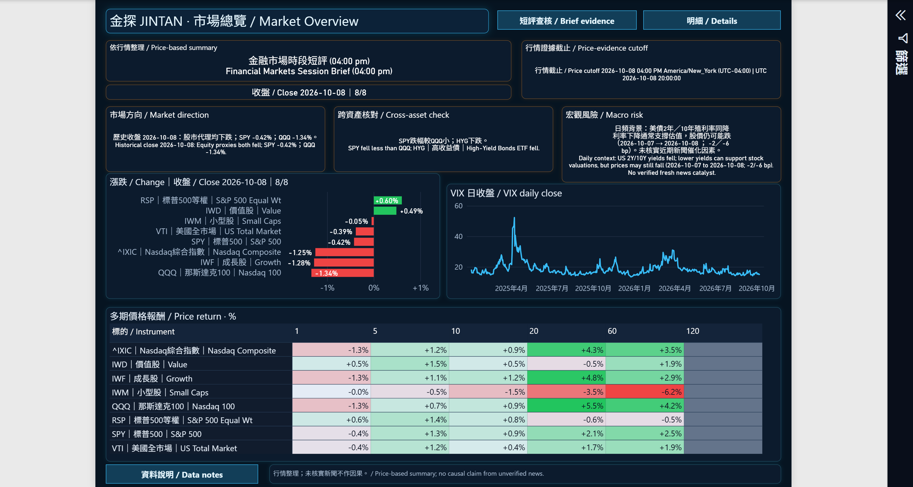
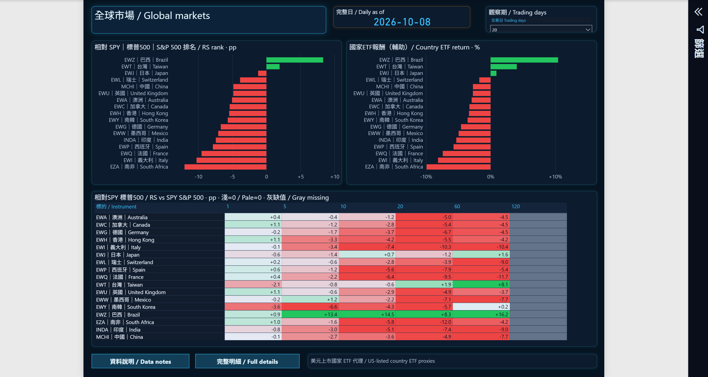
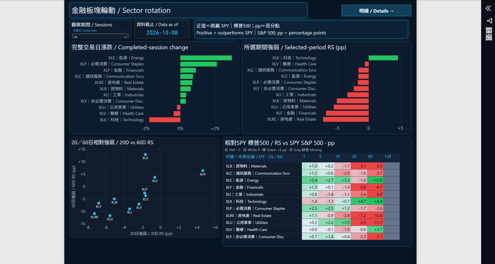
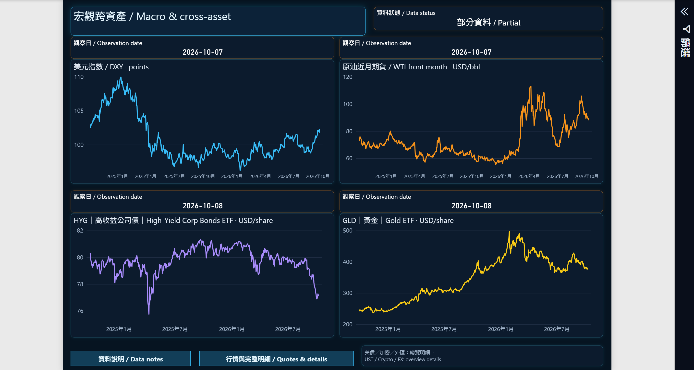
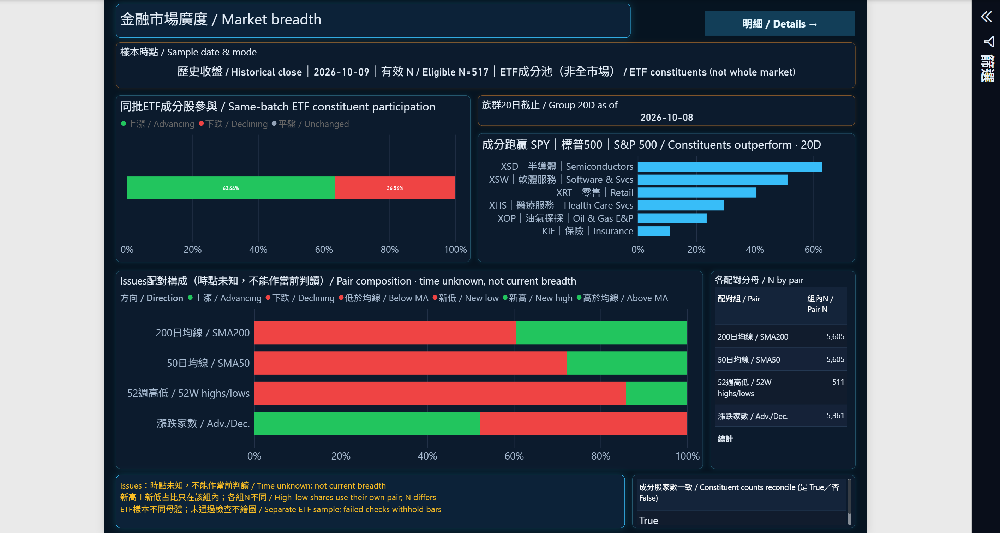
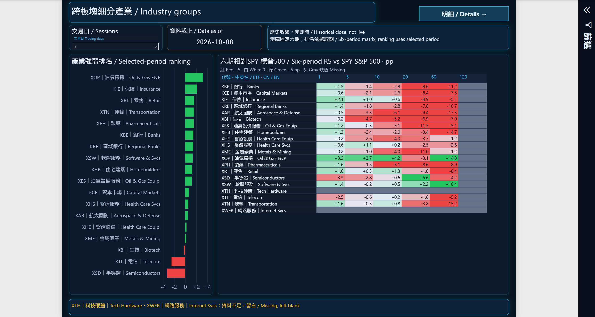
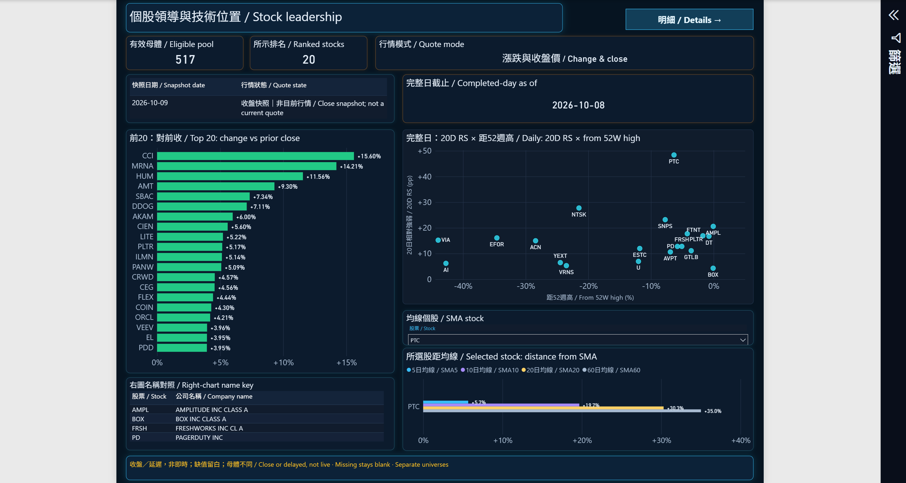

# 金探｜美股與全球市場 ETF 觀察儀表板

作者：施建宏（James Shih）

把分散的市場資訊整理為「市場 → 全球 → 板塊 → 跨資產 → 廣度 → 族群 → 個股」的觀察路徑，讓比較帶有來源、日期、口徑與有效樣本。

## 2026-10-11 七頁展示

本作品使用 2026-10-11 保存的同一份報表七頁截圖。10/11 是展示截圖日期，圖內行情與來源日期主要為 10/07–10/09，請以各頁標示為準。尚未納入 10/12 後的圖示、Logo 等最後修正。

- [下載七頁 PDF](Jintan-showcase-20261011.pdf)
- [下載離線展示 ZIP](Jintan-offline-showcase-20261011.zip)：解壓縮後開啟 `index.html`
- 下方可直接瀏覽全部七頁原始截圖，點圖可放大

> 這是靜態作品展示。圖內按鈕、篩選器與提示文字僅是截圖內容，不能操作。資料更新與部分來源仍待完整驗證；本次展示不代表即時行情、完整刷新成功或互動驗收通過。

## 我的工作

定義研究問題與七頁閱讀流程，規劃指標口徑、資料品質門檻及缺漏呈現，串接資料處理、儲存與 Power BI 視覺。使用 AI 協助程式開發與異常追查，由我核對計算口徑與操作結果。

## 技術與資料來源

系統設計：Python 擷取、整理與計算 → GitHub Actions 排程 → PostgreSQL 儲存 → Power BI DirectQuery／DAX 呈現。

資料來源涵蓋 Alpaca SIP、State Street 官方 ETF 持倉、Yahoo 市場序列與新聞 RSS、Finviz 市場廣度、Cboe VIX。不同來源的觀察日、取得時間與資料延遲分開標示。

採集排程與 Desktop 重新查詢的設計間隔為 30 分鐘；採集、驗證與畫面查詢是不同步驟，不保證同步。合格延遲成交須通過時段、來源與成交年齡檢查；超時可能退回標明日期的歷史收盤。排程間隔不等於端到端資料延遲，本次靜態截圖不驗證排程運作。

## 七頁畫面

### 1. 市場總覽 / Market Overview

市場與風格代理、VIX 日線與多期報酬；短評分開呈現行情證據與宏觀背景。

行情證據截止為 2026-10-08；未核實新聞不作因果解釋。

### 2. 全球市場結構 / Global Markets

比較美國掛牌國家／地區 ETF 的報酬與相對 SPY 強弱，保留來源、日期與有效樣本。

美元 ETF 是市場代理，不是當地指數或當地即時行情。RS 以百分點計，報酬以百分比計。

### 3. 金融板塊輪動 / Sector Rotation

比較 11 大板塊的單日漲跌、所選期間 RS 與多期熱圖，另以 20 日／60 日 RS 觀察位置。

所選期間與比較口徑須分開閱讀；灰色空白保留缺漏，不補成 0。

### 4. 宏觀跨資產 / Macro & Cross-Asset

以美元指數、原油、高收益債與黃金的時間序列觀察跨資產背景。

各來源觀察日不同，保留 PARTIAL 狀態；不是同一時點的盤中快照。

### 5. 市場廣度 / Market Breadth

將 ETF 成分有效母體、板塊廣度與外部市場背景分開，呈現上漲／下跌比例和分母。

ETF 成分池不是全美股；不同分母與未知觀察時間保留標示。

### 6. 產業族群 / Industry Groups

從 20 檔產業 ETF 池比較所選期間 RS 與多期表現，呈現有效族群及資料缺口。

XTH／XWEB 缺漏保留；120 日空白不代表零報酬。

### 7. 個股領導與技術位置 / Stock Leadership

左側為前 20 名收盤快照；右側以完整日候選的 20 日 RS、距 52 週高及均線距離觀察技術位置。

快照日期 10/09 與完整日截止 10/08 分開；左右母體不同，部分散點標籤仍密集。

## 使用界線

- RS 為相對 SPY 的報酬差，不是 RSI；沒有資料不等於報酬為 0
- P7 收盤快照排名與完整日候選是不同母體，不能互套新聞、均線或量比
- 此次只提供公開展示用的七張截圖、PDF、離線網頁及版本說明；不含資料庫權限、原始行情資料、PBIX／PBIP、私人開發程式、連線設定或私人講稿
- 未部署 Power BI Service 或 GitHub Pages；GitHub README、PDF 和離線 ZIP 是本作品的瀏覽入口
- 本作品為研究與資料視覺化展示，不提供投資建議、自動下單或績效保證

上一版 2026-10-08 展示檔可從 Git 提交歷史回溯；目前首頁與下載入口以本版為準。
